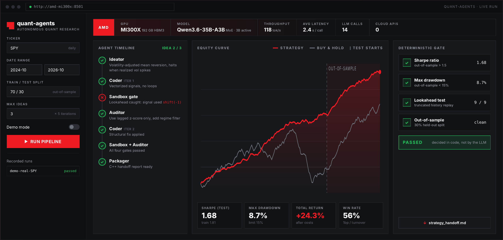
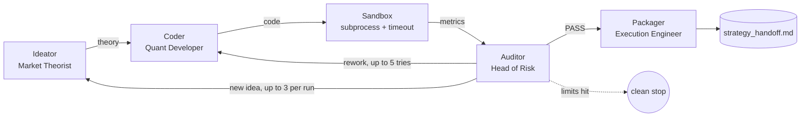

<div align="center">

# quant-agents

**An autonomous quant hedge fund in a box.**

AI agents do the quant research. Hard math keeps them honest.


</div>

---

## What it does

`quant-agents` runs quant research end to end, fully on AMD GPUs, with zero cloud APIs.

**Invent. Code. Test. Audit. Ship.**

1. An **Ideator** writes a market hypothesis with an economic rationale, entry/exit rules and regime filters.
2. A **Coder** turns it into vectorized pandas/numpy code. No loops.
3. A **Sandbox** runs the code in a subprocess with a timeout and computes the metrics.
4. An **Auditor** reviews the result and demands structural fixes, never parameter tweaking.
5. A **Packager** turns the survivor into a production handoff report with a C++ plan.

Most backtests lie: they are overfitted, they quietly use tomorrow's prices, and nobody notices for weeks. This system is built to catch that in minutes.

---

## Demo

<div align="center">
     
  <br>
  <sub>Live dashboard: agent timeline, out-of-sample equity curve and the deterministic gate.</sub>
</div>

Run it locally:

```bash
streamlit run dashboard.py
# open http://localhost:8501
```

---

## Architecture

One model. Four specialists. One loop.



| Agent | Role | Output |
| :--- | :--- | :--- |
| **Ideator** | Market Theorist | Alpha rationale, math formulation, regime filters |
| **Coder** | Quant Developer | `generate_signals(df) -> pd.Series` in `{-1, 0, 1}` |
| **Auditor** | Head of Risk | Traceback diagnosis or structural critique |
| **Packager** | Execution Engineer | Docs, Big-O, edge cases, C++ translation plan |

All four agents share **one** MoE model served by vLLM. LangGraph swaps the system prompt before each call, so there is no VRAM fragmentation and no multi-model juggling.

---

## The anti-cheating gate

**Pass or fail is decided in code. Not by the LLM.**

| Check | Rule |
| :--- | :--- |
| Lookahead truncation test | Replay on truncated history. If past signals change, auto-fail. |
| Out-of-sample only | 70 / 30 split. Judged on the 30% the agents never saw. |
| Transaction costs | 1 bp per unit of turnover. Every trade pays. |
| Hard thresholds | Sharpe **> 1.5** and Max Drawdown **< 15%**. No exceptions. |

Example: a naive backtest of `np.sign(close.shift(-1) - close)` scores Sharpe 21.0 with 0% drawdown. The gate rejects it instantly because it uses tomorrow's price.

---

## Results

Out of sample, after costs, SPY daily.

| Sharpe | Max Drawdown | Total Return | Win Rate |
| :---: | :---: | :---: | :---: |
| **1.58** | **11.2%** | **+9.4%** | **53%** |

Full report from the winning run: [`strategy_handoff.md`](strategy_handoff.md)

---

## Stack

| Layer | Choice |
| :--- | :--- |
| Hardware | AMD Instinct MI300X (192 GB HBM3) |
| Software | ROCm |
| Serving | vLLM, OpenAI-compatible API |
| Model | Qwen3.6-35B-A3B (MoE, 35B total, ~3B active per token) |
| Orchestration | LangGraph |
| Data | yfinance, with an offline `data/SPY.csv` fallback |

---

## Quick start

### 1. Get a GPU

Spin up a single MI300X droplet on the **[AMD Developer Cloud](https://www.amd.com/en/developer/resources/cloud-access/amd-developer-cloud.html)**. ROCm and Docker come preinstalled.

### 2. Download the model

Model page: **[Qwen/Qwen3.6-35B-A3B on Hugging Face](https://huggingface.co/Qwen/Qwen3.6-35B-A3B)**

```bash
pip install -U huggingface_hub
hf download Qwen/Qwen3.6-35B-A3B
```

### 3. Serve it with vLLM on ROCm

```bash
bash run_amd_vllm.sh
```

What the script runs:

```bash
docker run -it --rm --network=host \
  --device=/dev/kfd --device=/dev/dri --group-add video \
  --ipc=host --shm-size 16G \
  -v ~/.cache/huggingface:/root/.cache/huggingface \
  rocm/vllm:latest \
  vllm serve Qwen/Qwen3.6-35B-A3B \
    --reasoning-parser qwen3 \
    --max-model-len 32768 \
    --port 8000
```

`--reasoning-parser qwen3` keeps the model's thinking out of the code it returns.

### 4. Install and configure

```bash
git clone https://github.com/saifshbeita/quant-agents.git
cd quant-agents
pip install -r requirements.txt
cp .env.example .env
```

`.env`:

```env
LLM_BASE_URL=http://localhost:8000/v1
LLM_API_KEY=EMPTY
LLM_MODEL=Qwen/Qwen3.6-35B-A3B
```

### 5. Test and run

```bash
python test_system.py   # checks the server, data and sandbox
python main.py          # runs the full pipeline in the terminal
```

The winning strategy is saved to `strategy_handoff.md`. If no idea survives the gate, the run stops cleanly and prints why each one was rejected.

---

## Configuration

Set in `config.py` or `.env`.

| Variable | Default | Meaning |
| :--- | :---: | :--- |
| `BENCHMARK_SHARPE` | `1.5` | Minimum out-of-sample Sharpe |
| `MAX_DRAWDOWN_LIMIT` | `0.15` | Maximum out-of-sample drawdown |
| `MAX_ITERATIONS` | `5` | Coder rework attempts per idea |
| `MAX_IDEAS` | `3` | New hypotheses per run |
| `DEMO_MODE` | `false` | Looser thresholds for live demos |

---

## Project structure

```text
quant-agents/
├── agents/
│   ├── ideator.py        # Market Theorist
│   ├── coder.py          # Quant Developer
│   ├── auditor.py        # Head of Risk
│   └── packager.py       # Execution Engineer
├── core/
│   ├── state.py          # Shared AgentState
│   ├── sandbox.py        # Isolated execution, metrics, lookahead test
│   └── graph.py          # LangGraph state machine
├── data/
│   ├── fetcher.py        # yfinance with offline fallback
│   └── SPY.csv           # Cached daily SPY data
├── docs/
│   └── demo.png          # Dashboard screenshot
├── config.py             # Model and benchmark settings
├── dashboard.py          # Demo dashboard
├── main.py               # Terminal entry point
├── run_amd_vllm.sh       # ROCm + vLLM launch script
├── test_system.py        # Integration test
└── requirements.txt
```

---

## Why it matters

| | |
| :--- | :--- |
| **Audit trail** | Every rejected idea comes with a reason. |
| **Engineering ready** | A handoff report with a C++ plan. |
| **On-prem** | Private alpha never leaves your hardware. |

Built for quant researchers, small funds, prop trading desks and fintech teams.

---

## Team

**Saif Shbeita** · **Joud Ghannam**

Built for the AMD Developer Hackathon: ACT III.

> *Not financial advice. Backtests, even honest ones, do not guarantee future returns.*

<div align="center">
<br>
<code>.shift(1)</code>
<br>
<sub>One line of code keeps backtests honest. We built a whole system around it.</sub>
</div>
